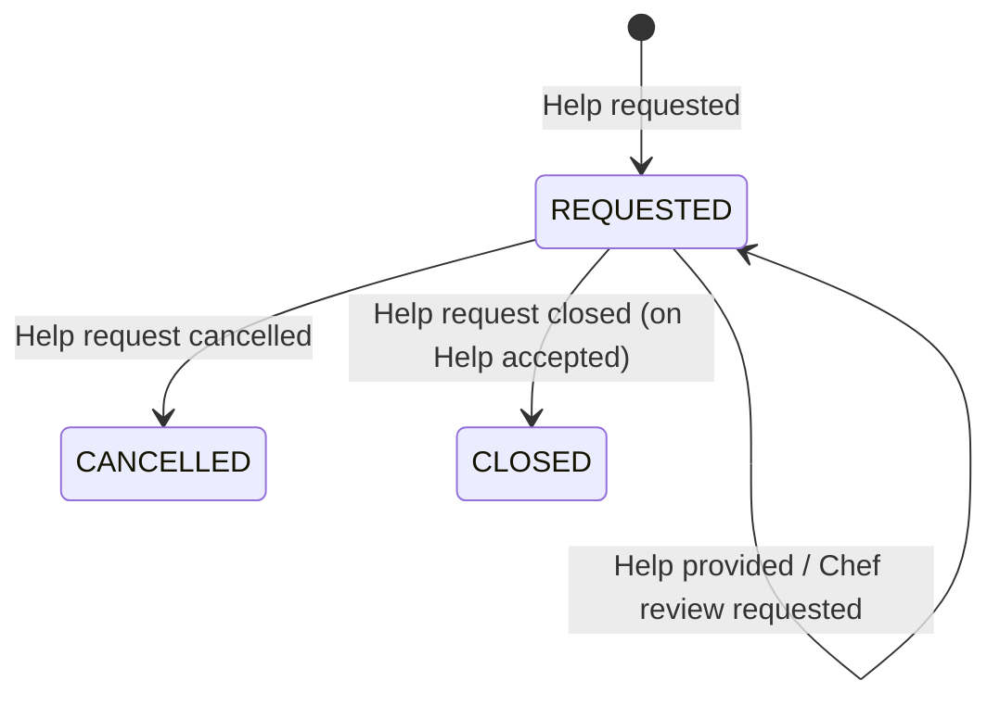

# Detail Design Brief — Cook Assistance (context brief, keyed by slice ID)

Step 2, 2026-10-24. Input: the four boards accepted in step 1 (B1 Meal plan, B2 Preparation step,
B3 Ingredients, B4 Catastrophe), their graph nodes, decisions F1–F6 and the slice plan
(`02-slice-plan.md`). The four per-board briefs share one shape and are kept as sections 1–3 of
`01-boards-and-slice-tables.md` (legend, transcription, slice tables); this file merges them.
Marks: **on board** = a sticky says it; **rule-derived** = from a rule sticky, confirmed by the user
(F2); **inferred** = not on any board — an open question until confirmed.

> **Revision r1 (step 3, 2026-10-24, Example Mapping Preparation step):** the timeout no longer
> depends on whether a help exists — the system cancels a REQUESTED request 5 h (per discriminator,
> F6) after it was requested **or after the last rejection**; a pending answer does not protect it.
> New command **Reject help** on Help (state **REJECTED**, terminal, cannot be accepted later; slice
> B1-S09) and policy **Restart answer deadline** on Help request (B1-S10). A Preparation step request
> needs a question text, at least one addressee (community and/or Grandma Avatar), and a step that
> exists in the recipe (Recipe Catalog lookup — new border). Only addressees may answer. Sections below
> that say otherwise are superseded by this note.

## 1. Legend and flavour
See `01-boards-and-slice-tables.md` §1. Design-Level; purple shield stickies are rules (not
policies); "Help REQUESTED" is a **state** sticky (graph: `hasState` on *Help requested*).

## 2. Slice table (merged)

| Slice | Trigger | Command | Aggregate | Event(s) | RM consulted | RM updated |
|---|---|---|---|---|---|---|
| B1-S01 | Cook | Request help meal plan | Help request (Menu) | Help requested | — | Help request |
| B1-S02 | Cook | Request Chef review *(rule-derived)* | Help request (Menu) | Chef review requested | Help | Help request |
| B1-S03 | Cook, Chef | Provide Help | Help | Help provided | Help request | Help |
| B1-S04 | message *Help provided* (Grandma Avatar AI) | Provide Help | Help | Help provided | Help request | Help |
| B1-S05 | Cook | Accept help *(rule-derived)* | Help | Help accepted | Help | Help |
| B1-S06 | Cook | Cancel help request *(rule-derived)* | Help request | Help request cancelled | Help request | Help request |
| B1-S07 | time | Cancel help request *(rule-derived)* | Help request | Help request cancelled | open help requests *(inferred)* | Help request |
| B2-S01 | Cook | Request help preparation step | Help request (Preparation step) | Help requested | — | Help request |
| B3-S01 | Cook | Request help ingredients | Help request (Ingredients) | Help requested | — | Help request |
| B4-S01 | Cook | Request help catastrophe | Help request (Catastrophe) | Help requested | — | Help request |
| B1-S08 | policy: whenever *Help accepted* | Close help request *(confirmed, 2026-10-24)* | Help request | Help request closed | — | Help request |

## 3. Aggregates and command handlers

### Help request
Purpose: a cook's request for help on one topic, open until answered, cancelled or timed out.
Minimal state: id · discriminator (Menu | Preparation step | Ingredients | Catastrophe) · requester
(cook) · status · requested-at (for the timeout) · recipe + step (Preparation step, Catastrophe) or
recipe + ingredient (Ingredients) · selected Chef (Menu, when asked).

| Command (slice) | Preconditions / invariants | Success | Failure |
|---|---|---|---|
| Request help meal plan (B1-S01) | Chef needs to be selected **(on board — Q: "must" or "may"?)**; only premium users may ask the Chef / Chef only when cook is premium **(on board, two stickies, one rule)** | Help requested (status REQUESTED) | rejection, not drawn |
| Request help preparation step (B2-S01) | recipe and step in recipe must be provided **(on board)**; Chef is not allowed — only community or Grandma **(on board)** | Help requested | rejection, not drawn |
| Request help catastrophe (B4-S01) | recipe and step in recipe must be provided; Chef not allowed **(on board)** | Help requested | rejection, not drawn |
| Request help ingredients (B3-S01) | recipe and ingredient in recipe must be provided; Chef not allowed **(on board)** | Help requested | rejection, not drawn |
| Request Chef review (B1-S02) | discriminator Menu; Grandma Avatar has provided help *(inferred)*; cook premium *(inferred from the Chef rules)* | Chef review requested | rejection, not drawn |
| Cancel help request — Cook (B1-S06) | requester only *(inferred; API canvas: "Only requester is allowed to")*; answer takes too long **(on board — threshold: open)**; status REQUESTED *(API canvas: "Only in status open")* | Help request cancelled | rejection, not drawn |
| Cancel help request — time (B1-S07) | status REQUESTED, **no Help provided for it yet (user, 2026-10-24)**, and requested-at + timeout passed: Menu 48 h, Ingredients 24 h, Catastrophe 10 min, Preparation step 5 h **(F6)** | Help request cancelled | — (no-op otherwise, inferred) |
| Close help request (B1-S08) | status REQUESTED; triggered by *Help accepted* for one of its helps **(user, 2026-10-24)** | Help request closed | — |

### Help
Purpose: one answer to one help request, by one provider.
Minimal state: id · help request id · discriminator · provider (kind: Chef | community cook |
Grandma Avatar, and identity) · content · status.

| Command (slice) | Preconditions / invariants | Success | Failure |
|---|---|---|---|
| Provide Help (B1-S03 actor, B1-S04 message) | help request exists and is REQUESTED *(inferred)*; cook cannot answer their own request **(on board)**; provider kind allowed for the discriminator — Menu: Chef, community or Grandma; others: community or Grandma **(on board, F4)**; Chef only if selected/premium *(inferred from B1)*; help is for one step in one recipe (Preparation step, Catastrophe) / one ingredient in one recipe (Ingredients) **(on board)** | Help provided (state Help PROVIDED, graph) | rejection, not drawn |
| Accept help (B1-S05) | requester of the help request only *(inferred)*; help is PROVIDED *(inferred)* | Help accepted | rejection, not drawn |

**Boundary flag:** every *Provide Help* guard except "one step/ingredient" needs Help request data
(status, requester, discriminator, selected Chef). Either the application service reads the Help
request and passes the facts in, or Help gets them at creation — a design decision for step 6.

## 4. Lifecycles

Help request — states (user, 2026-10-24): **REQUESTED**, **CLOSED**, **CANCELLED**. Providing help does
**not** change the request: it stays REQUESTED, can collect several helps, and closes when the cook
accepts one. Chef review: open whether it is a state (CHEF_REVIEW_REQUESTED, inferred) or only an event.

| From | Command / event | To |
|---|---|---|
| — | Request help <topic> → Help requested | REQUESTED |
| REQUESTED | Cancel help request (Cook or time) → Help request cancelled | CANCELLED (terminal) |
| REQUESTED | Close help request (policy on *Help accepted*) → Help request closed | CLOSED (terminal) |
| REQUESTED (Menu, a help by Grandma Avatar exists) | Request Chef review → Chef review requested | REQUESTED *(inferred: no state change)* |

Help — states on board: **PROVIDED**; rule-derived: **ACCEPTED**.

| From | Command / event | To |
|---|---|---|
| — | Provide Help → Help provided | PROVIDED |
| PROVIDED | Accept help → Help accepted | ACCEPTED (terminal) |

## 5. Policies and processes
No policy sticky on any board. From rules and decisions:
- **P1** whenever the answer timeout of a REQUESTED help request is reached then *Cancel help request* — time-triggered, within Help request; needs a read model of open requests with requested-at (not drawn). (B1-S07)
- **P2** whenever *Help provided* arrives from Grandma Avatar AI then *Provide Help* — cross-context, ACL (F3). (B1-S04)
- **P3** whenever *Help accepted* then *Close help request* — cross-aggregate, eventual (B1-S08, user 2026-10-24).
- P1 must know whether a help exists for the request ("only if no answer") — either a fact recorded on Help request or a lookup in the Help read model; decided in step 6/7.

Published (context map v2): *Help requested* → Grandma Avatar AI, Notification; *Help provided* →
Notification. Not decided: whether *Help request cancelled*, *Help accepted*, *Chef review requested*
leave the context (step 4).

## 6. Read models and UI
- **Help request** (green "Help request <topic>") — from Help requested, Help request cancelled, Chef review requested; read by the Cook (UI *Show help request*) and by providers choosing a request to answer *(inferred)*. Fields *(inferred)*: id, discriminator, status, recipe/step or ingredient, requested-at, requester.
- **Help** (green "Help <topic>") — from Help provided, Help accepted; read by the Cook (UI *Show help*). Fields *(inferred)*: id, help request id, provider kind, content, status.
- **Open help requests due** *(inferred, for P1)* — not on a board.

## 7. Completeness findings
1. Event without cause — none (after F2).
2. Command without handler — none.
3. Command without trigger — none.
4. Aggregate without invariant — none.
5. Happy path only — **every** command: no rejection events on any board; rejections become typed errors.
6. Policy without read model — P1 (open help requests due).
7. Decision without read model — *Request help <topic>*: no read model before it (recipe/step come from Meal Preparation by context map, not shown).
8. Wording — fine.
9. Language drift — (a) state names REQUESTED/PROVIDED (boards) vs Open/Answered (Help Request model, API canvas "Only in status open") — **resolved: REQUESTED, CLOSED, CANCELLED / PROVIDED, ACCEPTED**; (b) event *Help requested* (boards, map) vs *Help request created* (async canvas, earlier AsyncAPI); (c) "Help Meal plan" is the **answer** on the board but a **kind of Help Request** in glossary v2 (graph contradiction); (d) Help Request model types "Preparation Step Explanation", "Ingredient Substitute", "Menu proposal" vs discriminators (F5); (e) is the providing "Cook" the "Community Cook"?
10. Hotspots — none drawn. Graph contradictions: self-answers forbidden (boards) vs allowed except Chef (Help model); Catastrophe step mandatory (boards) vs only for Preparation step (Help Request model); Help Request at Community **and** Grandma (glossary) vs preferred provider 1..2 (model).

## 8. Effects on the slice plan and the skeleton
- **E1** *Provide Help* guards need Help request data → B1-S03/S04 depend on B1-S01-type slices (already in the plan) and read Help request; skeleton B1-S04 therefore touches both aggregates. No plan change.
- **E2 — resolved (user, 2026-10-24):** a help request stays REQUESTED when answered; it closes when the cook accepts a help (new slice **B1-S08**, policy on *Help accepted*); the timeout cancels only requests without any help. Consequence for step 4: the Notification AsyncAPI's `helpRequestStatus = ANSWERED` in *Help provided* has no matching state.
- **E3** Premium status comes from outside the context (graph Q: "How does Cooking Assistance learn that a cook is premium?") → B1-S01/S02 get an external dependency; increment 1 only.
- **E4** Skeleton B2-S01 + B1-S04 unaffected by E2 and E3.

## 9. Open questions (graph, for this brief)
Is a Help Request at a Community, a Grandma Avatar, or both? · Open/Answered or REQUESTED/PROVIDED? ·
When does a Help Request become closed? · *Help requested* or *Help request created* on the border? ·
Must the Chef be selected, or is the Chef one of three providers? · One ingredient per request and per
help, or several? · Is the providing Cook the Community Cook? · Is "premium" the "paying member"? ·
Same threshold for the cook's cancel as for the timeout? · Is Chef review a state or only an event?
