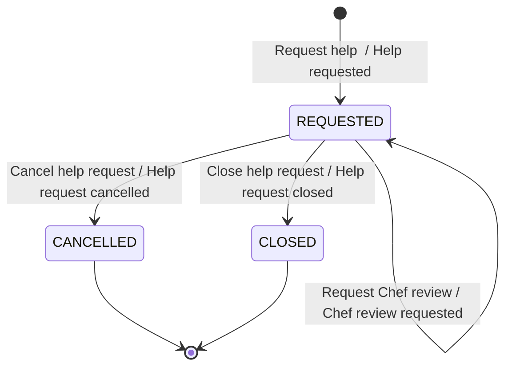
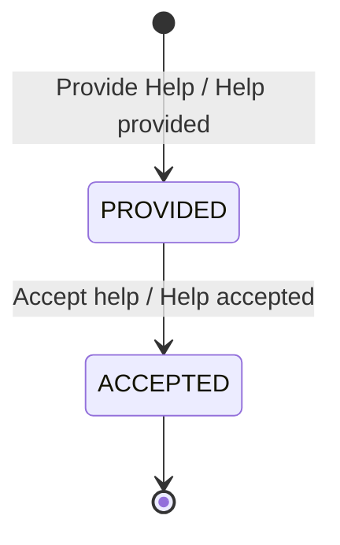

# Invariants — Cook Assistance, from the design-level boards (step 3b)

2026-10-24. Boards B1 Meal plan, B2 Preparation step, B3 Ingredients, B4 Catastrophe, read as in
`01-boards-and-slice-tables.md` and merged in `03-design-brief.md` (user decisions F1–F6, E2).
Candidate IDs `B-nn`; final `INV-nn` IDs are given in the merged sheet (3d).
Confidence: **on board** (a sticky says it) · **decided** (user decision in steps 1–2) · **implied**
(the board makes no sense otherwise) · **inferred** (needs confirming).

## 1. Board as read
See the slice tables. One state sticky on all four boards: "Help REQUESTED" on *Help requested* —
it belongs to **Help request** (the aggregate that event creates). No hotspots.

## 2. Consistency boundaries

| Context | Aggregate | Identity | Commands | States | Data it holds |
|---|---|---|---|---|---|
| Cook Assistance | Help request | help request id | Request help <topic>, Cancel help request (cook, time), Close help request, Request Chef review | REQUESTED, CLOSED, CANCELLED | discriminator, requester, status, requested-at, recipe + step / recipe + ingredient, selected Chef (Menu), has-help fact *(inferred, see B-09)* |
| Cook Assistance | Help | help id | Provide Help (actor, message), Accept help | PROVIDED, ACCEPTED | help request id, discriminator, requester (copy), provider kind + identity, recipe + step / ingredient, content |

## 3. Status models

**Help request**

| From | Command | Event | To | Guard |
|---|---|---|---|---|
| — | Request help <topic> | Help requested | REQUESTED | B-02…B-06 |
| REQUESTED | Cancel help request (cook) | Help request cancelled | CANCELLED | B-07, B-08 |
| REQUESTED | Cancel help request (time) | Help request cancelled | CANCELLED | B-09 |
| REQUESTED | Close help request | Help request closed | CLOSED | B-10 |
| REQUESTED | Request Chef review | Chef review requested | REQUESTED | B-11 |

**Help**

| From | Command | Event | To | Guard |
|---|---|---|---|---|
| — | Provide Help | Help provided | PROVIDED | B-12…B-17, B-19 |
| PROVIDED | Accept help | Help accepted | ACCEPTED | B-18 |




Invariants the machines assert: **B-01** (Help request legal transitions; CLOSED and CANCELLED are
terminal — no cancel, close or Chef review after them; going back is not drawn: a cook who wants help
again posts a **new** request — *inferred*) and **B-18** (ACCEPTED is terminal for a Help).

## 4. Invariants — context Cook Assistance

### Help request
| ID | Statement | Kind | Triggered by | Rejection | Evidence | Confidence |
|---|---|---|---|---|---|---|
| B-01 | Cancel, close and Chef review are accepted only while the request is REQUESTED; CLOSED and CANCELLED are terminal | state | Cancel, Close, Request Chef review | "This help request is already closed / cancelled." | state sticky "Help REQUESTED"; E2 | on board + decided |
| B-02 | A Preparation step or Catastrophe request MUST name a recipe and a step in that recipe | precondition | Request help preparation step / catastrophe | "Name the recipe and the step you need help with." | "Recipe and step in recipe must be provided" (B2, B4) | on board |
| B-03 | An Ingredients request MUST name a recipe and an ingredient in that recipe | precondition | Request help ingredients | "Name the recipe and the ingredient." | "Recipe and ingredient in recipe must be provided" (B3) | on board |
| B-04 | A Preparation step, Ingredients or Catastrophe request MUST NOT be addressed to a Chef — only community or Grandma | authorization of addressee | Request help (non-Menu) | "Chefs answer menu requests only." | "Chef is not allowed - only community or Grandma" (B2–B4), F4 | on board |
| B-05 | A Menu request addressed to a Chef MUST name the selected Chef | precondition | Request help meal plan | "Select a Chef." | "Chef needs to be selected" (B1) | on board — **must every Menu request go to a Chef, or only Chef-addressed ones?** |
| B-06 | Only a premium cook MAY address a Menu request to a Chef | authorization | Request help meal plan | "Asking a Chef is a premium feature — upgrade first." | "Only premium users allowed to ask Chef", "Chef can only be asked when cook is premium user." (B1) | on board — **premium is owned by another context: see §6 N-01** |
| B-07 | Only the requester MAY cancel their help request | authorization | Cancel help request (cook) | "Only the cook who asked can cancel." | "Cook can cancel **their** request" (B1–B4) | on board |
| B-08 | The cook MAY cancel only when the answer takes too long | precondition | Cancel help request (cook) | "<threshold> not yet reached." | same sticky | on board — **threshold unknown (same as F6?)** |
| B-09 | The system cancels a REQUESTED request when its timeout (Menu 48 h, Ingredients 24 h, Catastrophe 10 min, Preparation step 5 h) has passed **and no help exists for it** | state + ordering | time | — (no-op otherwise) | "System cancels request when answer takes too long" (B1–B4), F6, E2 | on board + decided — "no help exists" needs Help data: §6 N-02 |
| B-10 | A request is closed only when one of its helps is accepted | lifecycle | Close help request | — | E2 decision | decided — cross-aggregate: §6 N-03 |
| B-11 | A Chef review may be requested only for a Menu request of this cook that has a help by Grandma Avatar | precondition | Request Chef review | "There is no Grandma Avatar plan to review." | "Chef can review a dinner plan of Grandma Avartar." (B1), F2 | on board + inferred (own request, Grandma help) — needs Help data: §6 N-04 |

### Help
| ID | Statement | Kind | Triggered by | Rejection | Evidence | Confidence |
|---|---|---|---|---|---|---|
| B-12 | A help answers exactly one help request | cardinality | Provide Help | — (structural) | glossary "Help for 1 Help Request" | on board (glossary) |
| B-13 | A cook MUST NOT answer their own request | authorization | Provide Help (actor) | "You cannot answer your own request." | "Cook cannot answer their own request" (B1–B4) | on board — **contradicts Help model "except for Chef requests"** |
| B-14 | The provider kind MUST be allowed for the discriminator: Menu — Chef, community or Grandma Avatar; other three — community or Grandma Avatar | authorization | Provide Help | "Chefs answer menu requests only." | C06 (B1), C05 (B2–B4), F4 | on board + decided |
| B-15 | A Preparation step or Catastrophe help is for exactly the one step in the one recipe of its request | consistency | Provide Help | "This help is for a different step or recipe." | "Help is provided for one step in one recipe" (B2, B4) | on board |
| B-16 | An Ingredients help is for exactly the one ingredient in the one recipe of its request | consistency | Provide Help | "This help is for a different ingredient or recipe." | "Help is provided for one ingredient in one recipe" (B3) | on board |
| B-17 | Help may be provided only for a REQUESTED request | state (cross-aggregate) | Provide Help | "This request is closed / cancelled." | E2 | implied — needs Help request status: §6 N-05 |
| B-18 | Only the requester MAY accept a help, and only a PROVIDED one; ACCEPTED is terminal | authorization + state | Accept help | "Only the cook who asked can accept." / "Already accepted." | "Cook can accept the answer" (B1–B4) | on board (+ requester: implied) |
| B-19 | A Chef MAY answer only a Menu request that selected **this** Chef | authorization | Provide Help (Chef) | "This request was not addressed to you." | "Chef needs to be selected" (B1), SADR0001 "Chef needs to be accessed exclusively" | implied |

## 5. Scenarios (violations; happy paths in the merged sheet)

```gherkin
Scenario: B-02 A preparation-step request without a step is rejected
  Given no help request exists
   When Cook "C-1" issues Request help preparation step for recipe "Lasagne" without a step
   Then the command is rejected with "Name the recipe and the step you need help with."
    And no help request exists

Scenario: B-04 A catastrophe request cannot be addressed to a Chef
   When Cook "C-1" issues Request help catastrophe for recipe "Lasagne", step 3, addressed to Chef "Anna"
   Then the command is rejected with "Chefs answer menu requests only."

Scenario: B-13 A cook cannot answer their own request
  Given help request "HR-1" (Preparation step) by Cook "C-1" is REQUESTED
   When Cook "C-1" issues Provide Help for "HR-1"
   Then the command is rejected with "You cannot answer your own request."
    And no help exists for "HR-1"

Scenario: B-15 A help for a different step is rejected
  Given help request "HR-1" (Preparation step) for recipe "Lasagne", step 3 is REQUESTED
   When Grandma Avatar provides help for "HR-1" on recipe "Lasagne", step 4
   Then the command is rejected with "This help is for a different step or recipe."

Scenario: B-01 A cancelled request cannot be closed
  Given help request "HR-1" is CANCELLED
   When Close help request is issued for "HR-1"
   Then the command is rejected and "HR-1" stays CANCELLED

Scenario: B-09 A request with a help is not cancelled by the timeout
  Given help request "HR-1" (Catastrophe) was requested at 10:00 and has one help
   When the time is 10:10
   Then "HR-1" stays REQUESTED
```

## 6. Not invariants of one aggregate (policies, advisory guards)

| # | Rule | Test failed | Policy / enforcement | Staleness | Compensation |
|---|---|---|---|---|---|
| N-01 | B-06 premium | context (premium owned outside — Cook Profile "subscription Tier") | checked on a locally held fact at request time (token claim or replicated tier — step 5) | until the tier copy is refreshed | open: a downgraded cook's open Chef request — keep or cancel? |
| N-02 | B-09 "no help exists" | single owner (Help data) | whenever *Help provided* then record "has help" on Help request (policy) — or the timeout job checks the Help read model (advisory) | seconds | a help arriving after the cancel: rejected by B-17 |
| N-03 | B-10 close on accept | single owner | whenever *Help accepted* then *Close help request* (B1-S08) | seconds | none needed (accepting twice is refused by B-18) |
| N-04 | B-11 Grandma help exists | single owner | application service reads Help before the command (advisory) | seconds | — |
| N-05 | B-17 request still REQUESTED | single owner | application service reads Help request before Provide Help (advisory) | seconds | open: help provided to a request cancelled in the same second — keep or discard? |
| N-06 | B-13, B-14, B-15, B-16, B-19 need request data | — (immutable request data) | the request's requester, discriminator, recipe/step/ingredient and selected Chef are immutable, so a copy taken in the same use case cannot go stale | none | — |

Dropped: "Help REQUESTED" as a rule (it is a state); C17/C19 "Chef help visible only to the original
requester" is a **query-side** access rule (step 11), not a command invariant.

## 7. Gaps and questions
- **Numbers not supplied:** the cook-cancel threshold (B-08).
- **B-05:** must every Menu request be addressed to a Chef?
- **B-13 vs Help model:** may a cook answer their own request when it is not addressed to a Chef?
- **N-01:** what happens to an open Chef request when the cook stops being premium?
- **N-05:** a help that arrives for a request cancelled moments earlier — keep or discard?
- **Accept:** may several helps of one request be accepted (HR model v2 "at least one Help must be accepted")?
- **Missing command:** none for re-opening; a cancelled cook posts a new request *(inferred)*.
